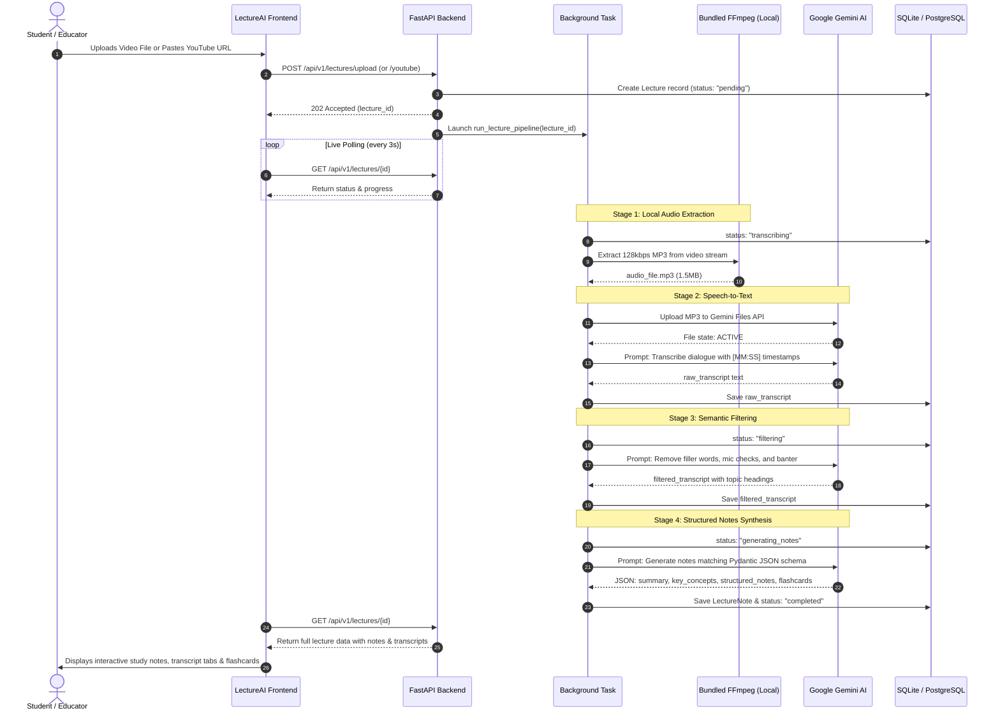
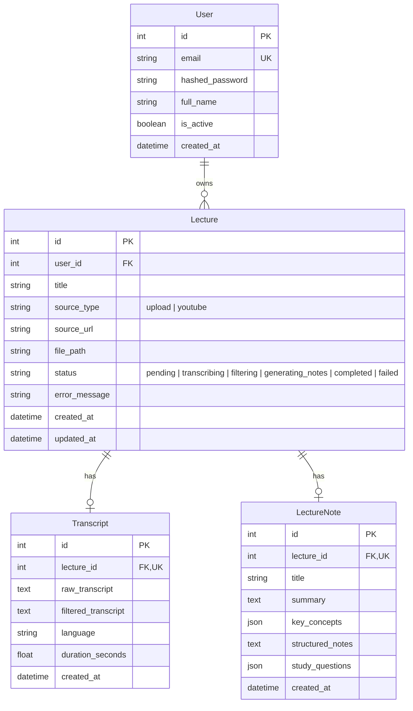

# LectureAI — Multimodal Lecture Ingestion, Transcript Filtering & Smart Notes Engine

LectureAI is an end-to-end multimodal lecture processing platform. It ingests video and audio recordings (via direct file upload or YouTube URL), extracts and transcribes dialogue with periodic timestamps, purges verbal clutter through semantic filtering, and synthesizes structured study notes, concept glossaries, and active-recall flashcards.

---

## Table of Contents
1. [Core Features](#core-features)
2. [The Hybrid Engine Architecture](#the-hybrid-engine-architecture)
3. [End-to-End System Workflow](#end-to-end-system-workflow)
4. [Technology Stack](#technology-stack)
5. [Database Architecture](#database-architecture)
6. [API Specification](#api-specification)
7. [Frontend Architecture & UI](#frontend-architecture--ui)
8. [Configuration & Environment](#configuration--environment)
9. [Installation & Quickstart](#installation--quickstart)
10. [Automated Testing](#automated-testing)

---

## Core Features

- **Dual Ingestion Hub**: Upload local lecture files (`.mp4`, `.mkv`, `.webm`, `.mov`, `.mp3`, `.wav`, `.m4a`) up to 500MB or provide a public YouTube lecture URL.
- **Hybrid Local-Cloud Processing Engine**: Leverages bundled FFmpeg for instant local audio extraction, reducing file transfer size by **up to 98%** before interacting with the cloud AI pipeline.
- **Accurate Speech-to-Text with Timestamps**: Uses Google Gemini to generate chronological lecture transcripts with periodic `[MM:SS]` anchors and speaker identification.
- **Semantic Verbal Clutter Filtering**: Cleans spoken lecture transcripts by eliminating filler sounds (*"um", "uh", "you know", "like"*), repetitive stutters, mic checks, and off-topic classroom chatter while preserving 100% of educational content and technical terminology.
- **Structured Study Material Synthesis**:
  - **Executive Summary**: 2–3 paragraph synthesized lecture brief.
  - **Key Concepts Glossary**: Definitions and context for every major term introduced.
  - **Structured Markdown Notes**: Deep hierarchy notes with headings, equations, code blocks, and key takeaways.
  - **Active-Recall Flashcards**: Question-and-answer pairs designed for self-testing and exam prep.
- **Real-Time Asynchronous Processing**: Non-blocking background worker (`BackgroundTasks`) with live status polling in the frontend.
- **One-Click Export**: Export notes directly to a `.md` Markdown file or copy to clipboard.

---

## The Hybrid Engine Architecture

A major challenge with processing raw video lectures through cloud multimodal AI is **container parsing failures, excessive bandwidth usage, and latency**. Large video recordings (e.g., 95MB camera files or YouTube DASH webm streams) often fail remote video decoding (e.g., Gemini `code 13: File failed to be processed`) or take minutes to upload.

To solve this, LectureAI uses a **Hybrid Engine** combining deterministic local audio extraction with cloud multimodal intelligence:

```
┌────────────────────────────────────────────────────────────────────────┐
│                        HYBRID PROCESSING ENGINE                        │
├──────────────────────────────────┬─────────────────────────────────────┤
│   DETERMINISTIC LOCAL STAGE      │         CLOUD AI SEMANTIC STAGE     │
│   (Zero API Cost, Ultra-Fast)    │       (Gemini 3.5 Flash Multimodal) │
├──────────────────────────────────┼─────────────────────────────────────┤
│ 1. Ingestion:                    │ 3. Speech-to-Text:                  │
│    • Multipart upload or yt-dlp  │    • Uploads 1.5MB MP3 to Files API │
│    • Stream verification         │    • Audio becomes ACTIVE instantly │
│                                  │    • Extracts raw transcript with   │
│ 2. Audio Extraction:             │      [MM:SS] timestamps             │
│    • Bundled imageio-ffmpeg      │                                     │
│    • Transcodes to 128kbps MP3   │ 4. Semantic Filtering:              │
│    • Compresses 95MB video       │    • Purges filler words & banter   │
│      down to 1.5MB in ~1.5s      │    • Corrects phonetic jargon       │
│    • Eliminates video decoding   │    • Inserts topic chapter headers  │
│      failure points              │                                     │
│                                  │ 5. Structured Note Generation:      │
│                                  │    • Strict Pydantic JSON schema    │
│                                  │    • Generates summary, concepts,   │
│                                  │      Markdown notes, and flashcards │
└──────────────────────────────────┴─────────────────────────────────────┘
```

### Key Advantages of the Hybrid Approach:
1. **Bandwidth & Speed**: Uploading a 1.5MB MP3 takes under 1 second, compared to 30–60 seconds for a raw 100MB video.
2. **Reliability (Zero Container Errors)**: Audio files become `ACTIVE` immediately on Gemini Files API without hitting video decoding timeouts or unsupported codec errors.
3. **Fault-Tolerant Resilience**:
   - `execute_with_retry()` automatically applies exponential backoff if temporary server demand spikes (`503 UNAVAILABLE`) or rate limits (`429 RESOURCE_EXHAUSTED`) occur.
   - Dynamic model fallback ensures uninterrupted note generation.

---

## End-to-End System Workflow



---

## Technology Stack

| Layer | Technology | Purpose |
| :--- | :--- | :--- |
| **Frontend Framework** | Vanilla HTML5 & Modern CSS3 | Ultra-fast, zero-build dashboard with glassmorphism & responsive layouts |
| **Typography & Icons** | Outfit, Inter, JetBrains Mono, FontAwesome 6 | Clean hierarchy, modern aesthetics, and monospace code/timestamps |
| **Markdown Rendering** | Marked.js | Renders generated lecture notes into structured HTML |
| **Web Server / Backend**| FastAPI (ASGI) & Uvicorn | High-performance asynchronous REST API framework |
| **Configuration & Validation**| Pydantic v2 & `pydantic-settings` | Type-safe settings, request/response validation, and JSON schemas |
| **AI Foundation Engine** | Google Gemini (`google-genai` SDK) | Multimodal speech-to-text, transcript filtering, and note synthesis |
| **Audio/Video Extraction** | `imageio-ffmpeg` (Bundled FFmpeg 7.1) | Portable, zero-config local audio extraction and container remuxing |
| **YouTube Media Ingestion**| `yt-dlp` | Reliable extraction of audio streams from YouTube URLs |
| **File I/O** | `aiofiles` | Non-blocking async chunked uploads (up to 500MB) |
| **ORM & Database** | SQLAlchemy 2.0 (Mapped Column Type-Safe) | Object-relational mapping supporting SQLite and PostgreSQL |
| **Authentication & Security**| Bcrypt & PyJWT | Password hashing and OAuth2 Bearer token generation |

---

## Database Architecture

The data model uses SQLAlchemy 2.0 declarative mappings:



---

## API Specification

All lecture endpoints are namespaced under `/api/v1/lectures`:

| Method | Endpoint | Description |
| :--- | :--- | :--- |
| `POST` | `/api/v1/lectures/upload` | Upload a video/audio file (multipart/form-data) and launch background pipeline |
| `POST` | `/api/v1/lectures/youtube` | Provide a YouTube video URL (`{"url": "..."}`) to download and process |
| `GET` | `/api/v1/lectures/` | List all processed or in-progress lectures (supports `skip` & `limit`) |
| `GET` | `/api/v1/lectures/{id}` | Retrieve lecture metadata, current pipeline status, transcript, and notes |
| `GET` | `/api/v1/lectures/{id}/transcript` | Get raw and filtered transcripts |
| `GET` | `/api/v1/lectures/{id}/notes` | Get generated executive summary, key concepts, notes, and study flashcards |
| `GET` | `/api/v1/lectures/{id}/notes/markdown`| Download generated lecture notes directly as a `.md` Markdown file |
| `POST` | `/api/v1/lectures/{id}/filter` | Re-run transcript filtering with custom instructions |
| `POST` | `/api/v1/lectures/{id}/generate-notes`| Re-generate notes with custom focus (e.g. "Exam Cram", "Formula Focus") |
| `DELETE`| `/api/v1/lectures/{id}` | Delete lecture, associated database records, and local audio/video files |
| `GET` | `/health` | Health-check endpoint returning `{"status": "ok"}` |

---

## Frontend Architecture & UI

The frontend is served directly by FastAPI via Starlette `StaticFiles` at `/`:
- **Single-page Architecture**: Built with modular vanilla JavaScript ([app.js](file:///d:/HCLTECH/static/js/app.js)) and semantic HTML5 ([index.html](file:///d:/HCLTECH/static/index.html)).
- **Design System ([style.css](file:///d:/HCLTECH/static/css/style.css))**:
  - Dark-mode glassmorphic theme with tailored HSL tokens.
  - Interactive tabs for switching between Study Notes, Filtered Transcripts, Raw Dialogue, Key Concepts Glossary, and Flashcards.
  - Interactive 3D flip card animations for active-recall quizzes.
  - Real-time pipeline stepper that tracks upload, transcription, filtering, and note synthesis.

---

## Configuration & Environment

Environment variables are managed in `.env`:

```env
# Application Settings
PROJECT_NAME="LectureAI API"
API_V1_PREFIX=/api/v1

# Database Configuration (SQLite by default, swap for PostgreSQL in production)
DATABASE_URL=sqlite:///./app.db

# Security & JWT Tokens
SECRET_KEY=your-secret-key-change-in-production
ALGORITHM=HS256
ACCESS_TOKEN_EXPIRE_MINUTES=60

# Google Gemini API Settings (Get your key from https://aistudio.google.com/)
GEMINI_API_KEY=your_actual_gemini_api_key
GEMINI_MODEL=gemini-3.5-flash
UPLOAD_DIR=uploads
```

---

## Installation & Quickstart

### Prerequisites
- Python 3.10+ (tested on Python 3.13)
- Windows / macOS / Linux

### 1. Clone & Setup Virtual Environment
```powershell
# Navigate to workspace
cd d:\HCLTECH

# Activate virtual environment
.\app\.venv\Scripts\Activate.ps1
```

### 2. Install Dependencies
```powershell
pip install -r requirements.txt
```

### 3. Configure Gemini API Key
Add your API key to `.env`:
```env
GEMINI_API_KEY=your_actual_gemini_api_key
```

### 4. Run the Application
```powershell
python -m uvicorn app.main:app --reload --port 8000
```

### 5. Access the Platform
- **Web Dashboard**: [http://localhost:8000/](http://localhost:8000/)
- **Interactive Swagger Docs**: [http://localhost:8000/docs](http://localhost:8000/docs)
- **Alternative ReDoc**: [http://localhost:8000/redoc](http://localhost:8000/redoc)

---

## Automated Testing

An automated integration test suite is located in [tests/test_lectures.py](file:///d:/HCLTECH/tests/test_lectures.py).

To execute the test suite:
```powershell
python -c "import tests.test_lectures as t; t.setup_module(); t.test_health_check(); t.test_upload_lecture_and_lifecycle(); print('All tests passed!')"
```
The suite validates:
1. `/health` connectivity
2. Direct file upload & lifecycle management
3. Database record persistence across `Lecture`, `Transcript`, and `LectureNote`
4. Transcript filtering and Markdown notes download endpoints
5. File cleanup on deletion
