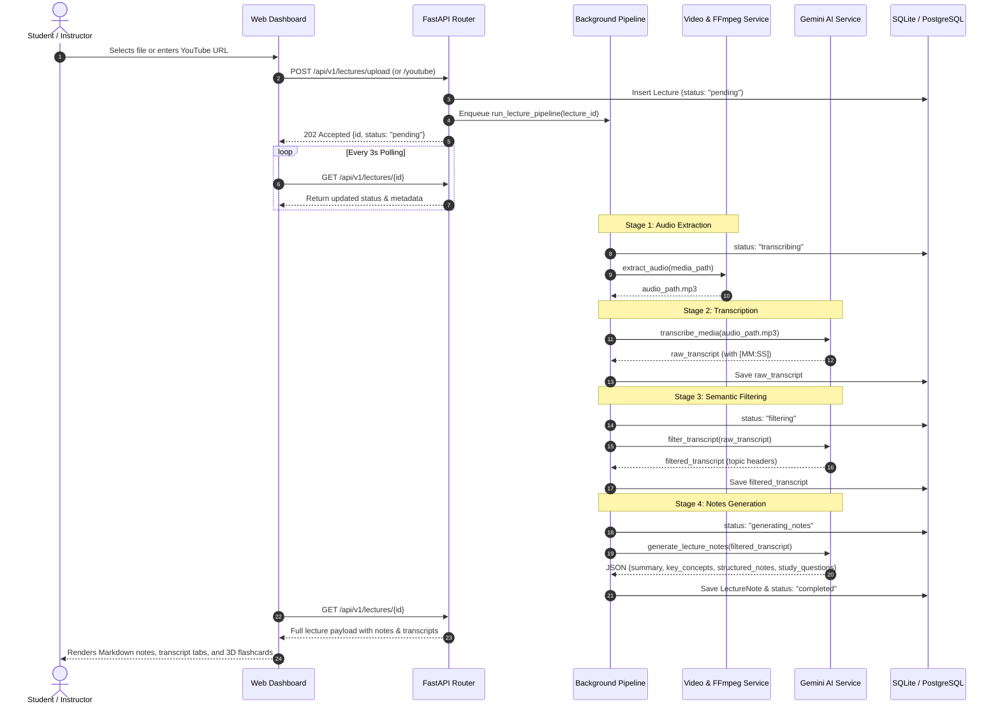

# LectureAI: System Architecture, Hybrid Engine & Workflow Documentation

## 1. System Overview

**LectureAI** is an intelligent multimodal lecture processing system that bridges the gap between raw spoken educational media (video or audio) and high-yield, structured study resources. It ingests video recordings or YouTube URLs, extracts clean dialogue with timestamps, strips out verbal clutter through semantic filtering, and synthesizes comprehensive study notes, key concept glossaries, and active-recall flashcards.

---

## 2. The Hybrid Processing Engine

A core innovation in this platform is the **Hybrid Engine**. Instead of directly piping large, high-resolution video streams (e.g. 100MB+ MP4 files or fragmented YouTube DASH webm streams) to cloud multimodal endpoints—which causes video container decoding errors, network timeouts, and excessive bandwidth consumption—the platform uses a two-tier hybrid model:

```mermaid
flowchart TD
    subgraph Tier1["Tier 1: Deterministic Local Processing (Zero Latency & 0 Cost)"]
        A[Input Video / YouTube URL] --> B[Local Stream Ingestion]
        B --> C[Bundled imageio-ffmpeg 7.1]
        C -->|Transcodes to 128kbps MP3| D[Compressed Audio Stream<br/>~1.5MB vs 95MB Original]
    end

    subgraph Tier2["Tier 2: Cloud Multimodal Semantic AI (Google Gemini 3.5 Flash)"]
        D --> E[Gemini Files API Upload<br/>Instant ACTIVE State]
        E --> F[Speech-to-Text Stage<br/>Extracts Raw Dialogue + [MM:SS] Timestamps]
        F --> G[Semantic Filtering Stage<br/>Purges Verbal Fillers & Mic Checks]
        G --> H[Structured Synthesis Stage<br/>Generates JSON Schema: Summary, Notes, Quiz]
    end

    H --> I[(SQLAlchemy 2.0 Database)]
    I --> J[Reactive Frontend Dashboard]
```

### Why the Hybrid Architecture is Essential:
1. **98% Data Reduction**: A 95MB video is compressed locally into a 1.5MB MP3 in ~1.5 seconds.
2. **Eliminates Codec Failures**: Bypasses cloud video decoding errors (`code 13: File failed to be processed`) that happen with raw camera files or DASH webm containers.
3. **Instant API Activation**: MP3 audio streams transition to `ACTIVE` state on Gemini Files API in under a second.
4. **Adaptive Resilience**: Implements `execute_with_retry()` with exponential backoff to handle temporary cloud congestion (`503 UNAVAILABLE`) or free-tier rate limits (`429 RESOURCE_EXHAUSTED`).

---

## 3. End-to-End Execution Flow



---

## 4. Technology Stack Breakdown

| Category | Component | Details |
| :--- | :--- | :--- |
| **API Framework** | [FastAPI](https://fastapi.tiangolo.com/) | Asynchronous routing, lifespan events, dependency injection, and automatic OpenAPI generation |
| **ASGI Server** | [Uvicorn](https://www.uvicorn.org/) | Lightning-fast ASGI web server with file reloading |
| **Data Validation** | [Pydantic v2](https://docs.pydantic.dev/) | Strict data parsing, serialization, and JSON schema enforcement |
| **Configuration** | `pydantic-settings` | Centralized environment variable management with live fallback validators |
| **ORM & Database** | [SQLAlchemy 2.0](https://www.sqlalchemy.org/) | Type-safe declarative models (`Mapped`, `mapped_column`) with SQLite & PostgreSQL support |
| **Multimodal Foundation AI**| Google Gemini (`google-genai` SDK) | Gemini 3.5 Flash for audio transcription, prompt-based transcript filtering, and note synthesis |
| **Audio/Video Engine**| `imageio-ffmpeg` | Self-contained static FFmpeg 7.1 binary for deterministic local media transcoding |
| **YouTube Extraction**| `yt-dlp` | Audio extraction and metadata parsing with integrated FFmpeg post-processing |
| **Frontend Core** | HTML5, CSS3, Vanilla JS | Zero-build single page dashboard served directly via FastAPI StaticFiles |
| **Typography & Icons** | Google Fonts & FontAwesome 6 | Outfit, Inter, JetBrains Mono, and FontAwesome icons |
| **Markdown Parser** | Marked.js | Client-side renderer for structured Markdown lecture notes |

---

## 5. API Reference

All endpoints are hosted under `/api/v1/lectures`:

```
POST   /api/v1/lectures/upload             Upload video/audio file (multipart/form-data)
POST   /api/v1/lectures/youtube            Ingest YouTube video (JSON: {"url": "..."})
GET    /api/v1/lectures/                   List all lectures (paginated)
GET    /api/v1/lectures/{id}               Get lecture status, transcript, and notes
GET    /api/v1/lectures/{id}/transcript    Retrieve raw and filtered transcripts
GET    /api/v1/lectures/{id}/notes         Retrieve structured notes, summary & quiz
GET    /api/v1/lectures/{id}/notes/markdown Download notes directly as a .md file
POST   /api/v1/lectures/{id}/filter        Re-filter transcript with custom prompt
POST   /api/v1/lectures/{id}/generate-notes Re-generate notes with custom style/focus
DELETE /api/v1/lectures/{id}               Delete lecture, records, and media files
GET    /health                             Health check endpoint
```
